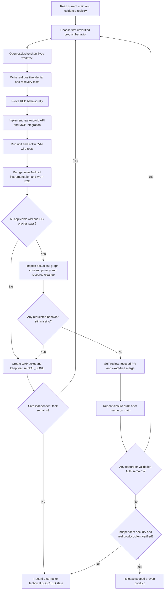

# Android Native MCP — V3 End-to-End Design-to-Delivery Implementation Plan

**Date:** 2026-10-14, Sydney
**Current status:** PROPOSED / NOT IMPLEMENTED / NO V3 POSITIVE E2E PASSES CLAIMED.
**Source of truth:** [V3 architecture](Android_Native_MCP_E2E_Architecture_Design_V3_2026-10-14.md), [192-case V3 E2E test matrix](Android_Native_MCP_E2E_Acceptance_Matrix_V3_2026-10-14.md), [machine-readable case registry](Android_Native_MCP_E2E_Acceptance_Registry_V3_2026-10-14.json), [70-package execution registry](Android_Native_MCP_V3_Work_Package_Registry_2026-10-14.json).
**Repository:** [grammy-jiang/android-mcp](https://github.com/grammy-jiang/android-mcp)
**Audited Native baseline:** `184f8c4afcffd4d49e393e14c6c08ca4ec8cb175`; later `main` changes must be re-audited, merged and retested.
**Historical prior delivery:** N0.a–N8.b = 38 safely merged work packages; not equivalent to production Native feature completion.
**Change policy:** This V3 document is for planning. No repository code, Git history, emulator state, Android permissions or physical device were changed when creating this deliverable.

## 1. Executive delivery contract — the gate V1/V2 missed

The product is a **real Android Native MCP**, not a repository full of nonexecuting plan classes. For each in-scope feature, the positive path must be achieved by the **installed Native APK through a real MCP client, a real Android API, and an independently verified OS effect**. Refusal, wrong identity, revoked consent, Stop, timeout, process death, retries, concurrent requests and cleanup must also have representative real tests on each applicable API 30/33/34/36.

The actual, independent acceptance states are:

| State | What it proves | Can count as feature complete? |
| --- | --- | --- |
| `ENGINEERING_INCREMENT_MERGED` | A bounded PR passed its own tests and is on `main` | **No** |
| `PASS_UNIT` / `PASS_JVM` / `PASS_MOCK` / `PASS_ADB_HARNESS` | Internal behavior, mocks, external ADB-driven test UI | **No** |
| `PASS_ANDROID_INSTRUMENTATION` | Real on-device Android API callback and/or OS state | **No**, unless paired to actual MCP call and independent result |
| `PASS_REAL_MCP_E2E` | Real MCP → Native → Android effect + external oracle and required negatives | **Possible** only after profile gates |
| `EMULATOR_FUNCTION_DONE` | Required positive + failure + four-API evidence for that feature in disposable lab | **Yes for emulator debug scope**, not physical/production |
| `PRODUCTION_FUNCTION_DONE` | Above + appropriate independent security/permission review and approved deployment scope | **Yes for that specific release profile** |
| `BLOCKED_EXTERNAL` / `UNSUPPORTED_BY_PLATFORM` / `GAP_OPEN` | Unmet prerequisite or platform boundary | **No**, unless explicitly classified as approved non-goal with a proven fallback |

**No completion laundering.** A developer must not set `PRODUCT_DONE` from a count of passing unit tests, merged PRs, green Android APK builds or denied-as-designed stubs. If genuine execution cannot yet be authorized, keep the feature `NOT_DONE` / `BLOCKED_EXTERNAL` and continue independent executable work. The developer must never invent Android OS user consent, an external independent review, a signed Host identity or permission to affect a real physical tablet.

### Exact product gates

- **Core emulator release:** N01–N06, N13 (supported Android status subset), N14, N16, and N17 read-auth have real client/OS E2E, version matrix, all normal/error/recovery evidence and clean packaging. N18 lease controls become mandatory as soon as writes are enabled, even in the test profile.
- **User-consented emulator release:** N07–N12, N15 as scoped features with real Android OS consent and fixture-only effects, N17 authentication and N18 fencing before any write. All behavior must pass across supported API variants.
- **Managed lab:** N19 only with approved isolated fresh Test DPC/DeviceOwner lab; this is not a generic production device capability.
- **Root/ROM:** N20 is explicitly **unsupported for ordinary Native APK**; the qualified outcome is an honest negative plus separately authenticated Host **read-only** fallback, never Native root/flashing.
- **Physical production:** Optional separate E15 with genuine operator authorization and any independent privilege review; neither emulator success nor a synthetic claim grants it.

## 2. Frozen requirements, test-case arithmetic and admission gate

The 20 N01–N20 families have **160** new specifically enumerated V3 cases (8 each), plus **32** cross-cutting cases (`V3-XR-01`–`32`): **192 new distinct test specifications**. The existing **228** `T-Nxx-01`–`06` specifications remain mandatory and are retained as **228 traceability rows**. These quantities are *specifications, not currently passing executions*, and some mapped cases may reuse one real run as evidence only if all separately required checks are independently asserted and attributed.

**The final acceptance registry must satisfy both:** `192/192` V3 requirements have a test implementation and recorded disposition, and `228/228` legacy cases map to executable tests with proper evidence class. For in-scope runnable features, any applicable test that is failed, not run, blocked, only mock-proven or lacks a positive Android effect keeps the feature incomplete. For N19/N20 and real hardware, an explicitly approved scope/OS limitation may yield an accurate `UNSUPPORTED` or release-blocking `BLOCKED_EXTERNAL`—never a fake positive result.

### Per-case evidence fields — mandatory before credit

`case_id`, old spec IDs where applicable, exact `git_head` and Git tree, signed APK SHA256 and test fixture signing digest, JDK/SDK/AGP/API/ABI, emulator serial plus independent ownership and boot-identity proof, actual runtime process/Android component, initiating real MCP `tools/list`/`tools/call` JSON (redacted), authenticated principal and OS consent callback where applicable, Android API invoked and callback status, independent OS/fixture observable outcome, negative/Stop/timeout/recovery results, session/journal/resource cleanup, review and signed-off scope, logs/artifact handles with retention, truthfully recorded result and open GAP IDs.

Implement the **mechanical acceptance evaluator** first (E00.c). For any row missing evidence, its status is never upgraded automatically. Test harness must distinguish `Native APK caused effect` from `Host ADB caused effect`. The final validator must examine the currently installed APK's actual public Tool registry, not names in a Kotlin class that is never reachable from Android entry points.

## 3. Safety/ownership assumptions that are NOT granted by this plan

The four known QEMU devices (Mac: API30/33/34/36, serials recorded in the V2 audit) are available for **eligibility checks**, not permanently reserved for arbitrary destructive experiments. Before every test, prove exact QEMU/API/ABI/system image, exclusive AVD owner, boot epoch and no active Host development. Do not use physical Android implicitly. A separate **brand-new** owned disposable AVD is required for admin Test DPC and other reset-sensitive research. No Root, raw shell execution, destructive wipe, bootloader unlock, unapproved install/permissions, external public listener, Play publication or paid GitHub Actions is authorized by writing this document.

Host owns `host/**`, Native owns `android/**`, and shared `contracts/**` is a separately named integration train C0→Host→Native, with both consumers' schema tests. Serial development means one active Native package at a time with an isolated worktree and Git PR. The Host side has an independent writer and can advance main; Native must always rebase/merge the actual current baseline, retest and compare exact merged Git trees.

## 4. Strictly serial working flow — do not stop at the middle



**Important:** A task may be safely merged as an incremental engineering unit while its enclosing Nxx feature remains NOT_DONE, but this must create a named next work package with ownership and due dependency. If the currently planned package's primary positive E2E cannot run, it is **not** permissible to call the package fully functional merely because a negative simulated fixture passes. Failure becomes an explicit GAP, not an exit ramp. The developer must continue through other independent tasks when possible; tool/session unavailability requires a durable checkpoint, not a claim of invisible background work.

### Mandatory repeating work loop — execute after EACH task, not just after stage

1. **Inventory:** Fetch actual upstream SHA, review other active worktrees/AVD sessions and baseline evidence; select next unresolved feature requirement (not merely next numerical PR).
2. **Test first:** Write unit and real E2E tests for one externally observable behavior. RED must be a meaningful failed behavioral assertion; synthetic compiler failures do not qualify.
3. **Complete vertical slice:** Real Kotlin Tool schema → live registry → verified policy → Android Activity/Service/Framework → OS callback/artifact. Do not leave an orphan adapter or permanent stub in a purported live feature.
4. **Prove OS effect:** Execute genuine app-on-emulator instrumentation and real MCP client; independent OS/fixture verifies success. For per-user authorization, observe actual OS consent and denial UI rather than injecting fake approved booleans.
5. **Prove rejection and recovery:** Wrong caller/Origin/Host, missing OS grant, user deny/revoke, process death, Stop, background, rotation, clock/expiry, duplicates, cross-Host races, memory/disk/provider faults as relevant.
6. **Check every API:** 30/33/34/36 on independently reserved QEMU and exact production/debug flavor, or grounded applicable OS exclusion. A generic N2/N3 status smoke does not certify screenshots/install/gestures.
7. **Inspect release surface:** `tools/list` reflects only intended capabilities; `tools/call` rechecks auth, privacy, consent, per-action grants, fencing; Manifest added permissions/components reviewed. Signed APK, lint, Gradle lock and all prior host/native regression gates pass.
8. **Reconcile tasks:** Compare original 228, V3 192, N01–N20 roster and every newly learned failure. If anything is missing, immediately append `GAP-Nxx-###` to backlog with reproduced error, owner, exact fix, tests, risk, and release blocker classification.
9. **Merge and prove exact same tree:** Short-lived PR, real targeted gate, updated Host main merge retest if necessary, merge to main and prove equality with the exact tested Git tree.
10. **Closure after merge:** Re-run bounded real E2E smoke on actual merged APK where possible; only then consider the Nxx capability's completion status. If a real use case remains unavailable, preserve NOT_DONE and add the next gap-fixing work package.
11. **Continue:** Execute next independent safe work package immediately. Do not wait for routine approval. If real external security approval/OS human consent is required, retain blocker and continue disjoint work; do not override the security gate or hide the incomplete feature.
12. **Final zero-gap review:** Stop the project as PRODUCT_DONE only when all required profiles meet every applicable acceptance test, including actual client interop and real OS effects, with no high-priority open implementation/test/security blockers. Explicit platform non-goals require written sign-off and verified Host fallback.

### How to create a GAP task (mandatory example)

```yaml
id: GAP-N15-001
found_in: E11.b
requirement: Native PackageInstaller approved user-confirmation must install pinned fixture APK
observation: fixture PackageInstaller UI never appears; simulated plan returns BLOCKED
why_not_done: no actual PackageInstaller Session.commit and OS result callback
owner: Native Android runtime
next_work_package: E11.b.fix01
depends_on: [E11.a]
required_positive_test: [V3-N15-01, V3-N15-02]
required_negative_recovery_test: [V3-N15-04, V3-N15-05, V3-N15-06]
independent_oracle: OS PackageManager reports exact signed package only after real approval
release_block: true
status: OPEN
```

A gap is closed only when its exact remediation is merged and validated against a real Android fixture. An unresolved external review cannot be closed by changing an expected status to `BLOCKED`.

## 5. Work-package priority, dependencies and substantive acceptance

**70** atomic V3 implementation work packages across **16** stages are defined below. This number is an initial planning baseline, **not a cap**. Every missing behavior, Android SDK discrepancy or untested failure path generates an additional necessary work package, even if the initial 70 have merged.

```text
E00 → E01 → E02 → E03 → E04 → E05 → E06 → E07 → E08 → E09 → E10 → E11 → E12 → E13 → E14
                     ↘ independent app/API tests while E02 contracts mature ↗
E15 physical approval is a separately controlled gate following E14, not an automatic CI step.
```

### E00 — Requirements, coverage and truthful status (P0; 4 work packages)

**Milestone outcome:** Capture requirements and sign-off the scope, create a source-backed readiness registry, preserve 38 safe-package history without crediting its mock tests as positive features.

**E00.a — Freeze the original full-lifecycle goal, 20 capabilities, release profiles, platform exclusions and real client acceptance; carry forward all open blocks.**
Dependencies: none; capability families: `N01`, `N02`, `N03`, `N04`, `N05`, `N06`, `N07`, `N08`, `N09`, `N10`, `N11`, `N12`, `N13`, `N14`, `N15`, `N16`, `N17`, `N18`, `N19`, `N20`.
**Required positive oracle:** Signed-off scope + exact source/Tool/Manifest inventory matched against original architecture.
**Negative/recovery/stop check:** A skipped or deferred feature remains NOT_DONE, never silently excluded.
**End-of-task gap question:** what expected feature remains uncallable from real MCP, and what OS effect/SDK/denial/recovery proof is missing? If any, create a GAP remediation package and keep owner capability NOT_DONE.

**E00.b — Map all 228 legacy T-Nxx test IDs to executable test identifiers, layer, code path, real-or-mock classification and current evidence.**
Dependencies: `E00.a`; capability families: `N01`, `N02`, `N03`, `N04`, `N05`, `N06`, `N07`, `N08`, `N09`, `N10`, `N11`, `N12`, `N13`, `N14`, `N15`, `N16`, `N17`, `N18`, `N19`, `N20`.
**Required positive oracle:** Automatically prove 228/228 traced with zero duplicate aliases or invented execution evidence.
**Negative/recovery/stop check:** Unmapped, failed or mock-only legacy tests create permanent GAP entries.
**End-of-task gap question:** what expected feature remains uncallable from real MCP, and what OS effect/SDK/denial/recovery proof is missing? If any, create a GAP remediation package and keep owner capability NOT_DONE.

**E00.c — Define and implement product-status taxonomy, capability closure ledger, independent OS-effect receipts and unforgeable PASS_REAL_E2E admission rules.**
Dependencies: `E00.b`; capability families: `N01`, `N16`.
**Required positive oracle:** Synthetic/mocked evidence demonstrably cannot promote a feature to DONE; gate has adversarial tests.
**Negative/recovery/stop check:** Missing SHA, OS oracle, consent, cleanup or applicable API is release blocking.
**End-of-task gap question:** what expected feature remains uncallable from real MCP, and what OS effect/SDK/denial/recovery proof is missing? If any, create a GAP remediation package and keep owner capability NOT_DONE.

**E00.d — Classify OS consent vs operator-scoped privilege vs independent external security review; record risk owners and fallback for every family.**
Dependencies: `E00.c`; capability families: `N17`, `N18`, `N19`, `N20`.
**Required positive oracle:** Every feature has an accountable risk/review/authorization owner and a supported exact target scope.
**Negative/recovery/stop check:** No generic model permission or self-claimed independent audit.
**End-of-task gap question:** what expected feature remains uncallable from real MCP, and what OS effect/SDK/denial/recovery proof is missing? If any, create a GAP remediation package and keep owner capability NOT_DONE.

**E00 exit:** Engineering deliverables are merged only after their own applicable tests and security gates pass. Infrastructure/document stages do NOT declare a product feature done; a functional owner becomes `FEATURE_DONE` only when its real externally observable outcome is proven. Missing approvals do not disappear into the next wave.

### E01 — Android instrumentation and deterministic fixture environment (P0; 6 work packages)

**Milestone outcome:** All four verified disposable AVDs run actual AndroidJUnitRunner tests and a genuine MCP client test, with permission/UI fixtures and hard separation of ADB oracle from Native executor.

**E01.a — Add AndroidJUnitRunner and src/androidTest, dependency-locked instrumentation tasks and fixture-only build variants.**
Dependencies: `E00.c`; capability families: `N01`, `N16`.
**Required positive oracle:** Real runner reports at least one on-device test and app status observation on each API 30/33/34/36.
**Negative/recovery/stop check:** JVM-only tests cannot count as AndroidJUnitRunner tests.
**End-of-task gap question:** what expected feature remains uncallable from real MCP, and what OS effect/SDK/denial/recovery proof is missing? If any, create a GAP remediation package and keep owner capability NOT_DONE.

**E01.b — Create pinned signed deterministic fixture APK(s), UI tree/gesture counter, MediaProjection known pixels, files/provider, and APK installer target.**
Dependencies: `E01.a`; capability families: `N05`, `N07`, `N08`, `N09`, `N10`, `N11`, `N12`, `N15`.
**Required positive oracle:** Known fixture package/signature/pixels/bytes/hash independently verified in each owned AVD.
**Negative/recovery/stop check:** No uncontrolled test packages or use of real user documents.
**End-of-task gap question:** what expected feature remains uncallable from real MCP, and what OS effect/SDK/denial/recovery proof is missing? If any, create a GAP remediation package and keep owner capability NOT_DONE.

**E01.c — Implement OS UI consent harness for ActivityResult, Settings, SAF and PackageInstaller; permit ADB only as test driver/oracle.**
Dependencies: `E01.a`, `E01.b`; capability families: `N04`, `N07`, `N09`, `N10`, `N11`, `N15`.
**Required positive oracle:** Device-side instrumentation observes real OS callback and distinct approve/deny/cancel UI outcomes.
**Negative/recovery/stop check:** ADB shell pm grant or install cannot substitute for Native positive operation.
**End-of-task gap question:** what expected feature remains uncallable from real MCP, and what OS effect/SDK/denial/recovery proof is missing? If any, create a GAP remediation package and keep owner capability NOT_DONE.

**E01.d — Build independent genuine MCP Streamable HTTP client test runner and wire/contract oracle.**
Dependencies: `E01.a`; capability families: `N01`, `N17`.
**Required positive oracle:** On a real running emulator, caller exercises tools/list and tools/call and proves exact schema/result.
**Negative/recovery/stop check:** Disallow synthetic JVM server as application-level E2E proof.
**End-of-task gap question:** what expected feature remains uncallable from real MCP, and what OS effect/SDK/denial/recovery proof is missing? If any, create a GAP remediation package and keep owner capability NOT_DONE.

**E01.e — Implement AVD exclusive lease/preflight, exact boot/API/ABI/owner/nonce proof, fault injection, teardown and sanitized evidence.**
Dependencies: `E01.a`, `E01.c`, `E01.d`; capability families: `N16`, `N18`.
**Required positive oracle:** Each AVD identity and ownership independently verified before mutating fixture; no physical serial.
**Negative/recovery/stop check:** If busy, fail-closed and reschedule; never reset someone else’s AVD.
**End-of-task gap question:** what expected feature remains uncallable from real MCP, and what OS effect/SDK/denial/recovery proof is missing? If any, create a GAP remediation package and keep owner capability NOT_DONE.

**E01.f — Add independent Android instrumentation and full MCP E2E runs to each affected PR CI; prove failures block the gate.**
Dependencies: `E01.b`, `E01.c`, `E01.d`, `E01.e`; capability families: `N01`, `N16`.
**Required positive oracle:** An intentionally broken test case makes full CI fail; entire four-API baseline passes with genuine runner.
**Negative/recovery/stop check:** Legacy status-only QEMU matrix does not certify sensitive features.
**End-of-task gap question:** what expected feature remains uncallable from real MCP, and what OS effect/SDK/denial/recovery proof is missing? If any, create a GAP remediation package and keep owner capability NOT_DONE.

**E01 exit:** Engineering deliverables are merged only after their own applicable tests and security gates pass. Infrastructure/document stages do NOT declare a product feature done; a functional owner becomes `FEATURE_DONE` only when its real externally observable outcome is proven. Missing approvals do not disappear into the next wave.

### E02 — Authenticated transport, mutual pairing and public Tool policy (P0; 7 work packages)

**Milestone outcome:** Real Host and Native processes pair through explicit operator-owned bootstrap, use vetted authenticated confidential transport, and prove real MCP read authorization and revocation.

**E02.a — Run vetted transport library POC for confidential mutually authenticated Host↔Native session over explicit ADB forward/approved relay.**
Dependencies: `E01.d`, `E00.d`; capability families: `N17`.
**Required positive oracle:** Two real processes complete authenticated TLS-channel handshake; wire capture reveals no readable secrets.
**Negative/recovery/stop check:** No claim that ADB forward/Origin/localhost is authentication; no home-grown TLS.
**End-of-task gap question:** what expected feature remains uncallable from real MCP, and what OS effect/SDK/denial/recovery proof is missing? If any, create a GAP remediation package and keep owner capability NOT_DONE.

**E02.b — Freeze versioned shared v2 pairing/auth/permission/grant/lease schema and compatibility; coordinate C0→Host→Native PR train with named writers.**
Dependencies: `E02.a`; capability families: `N17`, `N18`.
**Required positive oracle:** Both real client implementations pass same wire schema and old device_status contract remains compatible.
**Negative/recovery/stop check:** No unreviewed common contracts edit or invented Host consumer acknowledgement.
**End-of-task gap question:** what expected feature remains uncallable from real MCP, and what OS effect/SDK/denial/recovery proof is missing? If any, create a GAP remediation package and keep owner capability NOT_DONE.

**E02.c — Wire AndroidKeyStore installation identity to user-visible local pairing UI and persistent owner binding with explicit fingerprint confirmation.**
Dependencies: `E02.b`; capability families: `N17`.
**Required positive oracle:** A real emulator UI pairs an exact Host public key; Android Keystore-backed signature is verified by Host.
**Negative/recovery/stop check:** Host/Native identity never inferred from serial or location; reject replaced key.
**End-of-task gap question:** what expected feature remains uncallable from real MCP, and what OS effect/SDK/denial/recovery proof is missing? If any, create a GAP remediation package and keep owner capability NOT_DONE.

**E02.d — Implement Native and Host mutually authenticated session lifecycle with key rotation, expiry, replay cache, revoke/unpair, OS boot/install epoch validation.**
Dependencies: `E02.c`; capability families: `N17`.
**Required positive oracle:** Two real clients prove accepted identity and wrong signer/replay/revoked identity refusal.
**Negative/recovery/stop check:** No secrets in logs, MCP response or Android backup; stop revokes.
**End-of-task gap question:** what expected feature remains uncallable from real MCP, and what OS effect/SDK/denial/recovery proof is missing? If any, create a GAP remediation package and keep owner capability NOT_DONE.

**E02.e — Register real Kotlin MCP tools/list and tools/call with session-scoped read profile + request authorization on every call.**
Dependencies: `E02.d`, `E01.d`; capability families: `N01`, `N17`.
**Required positive oracle:** Paired client sees permitted read tool and gets real result; anonymous/same-device peer cannot call sensitive tool.
**Negative/recovery/stop check:** Tool advertisement alone never authorizes execution, no privacy data before auth.
**End-of-task gap question:** what expected feature remains uncallable from real MCP, and what OS effect/SDK/denial/recovery proof is missing? If any, create a GAP remediation package and keep owner capability NOT_DONE.

**E02.f — Run second Mac/Linux Host and same-Android-hostile-peer tests, certificate replacement, disconnect/reconnect, boot/key epoch and malformed HTTP.**
Dependencies: `E02.d`, `E02.e`; capability families: `N17`.
**Required positive oracle:** Real client session key and OS state logs show correct authenticate/revoke/deny; API matrix pass.
**Negative/recovery/stop check:** No implicit privileges on reconnect, wrong Origin, cloned token or replay.
**End-of-task gap question:** what expected feature remains uncallable from real MCP, and what OS effect/SDK/denial/recovery proof is missing? If any, create a GAP remediation package and keep owner capability NOT_DONE.

**E02.g — Close N17 eight-case registry and XR01–XR08 security acceptance; record reviewed release scope S1.**
Dependencies: `E02.a`, `E02.b`, `E02.c`, `E02.d`, `E02.e`, `E02.f`; capability families: `N17`.
**Required positive oracle:** Every N17 and assigned XR case has actual Native+Host transport result and independent pairing oracle.
**Negative/recovery/stop check:** Without review/consent, pairing feature remains NOT_DONE in production despite emulator pass.
**Accountable test suite:** `V3-N17-01`, `V3-N17-02`, `V3-N17-03`, `V3-N17-04`, `V3-N17-05`, `V3-N17-06`, `V3-N17-07`, `V3-N17-08`, `V3-XR-01`, `V3-XR-02`, `V3-XR-03`, `V3-XR-04`, `V3-XR-05`, `V3-XR-06`, `V3-XR-07`, `V3-XR-08`.
**End-of-task gap question:** what expected feature remains uncallable from real MCP, and what OS effect/SDK/denial/recovery proof is missing? If any, create a GAP remediation package and keep owner capability NOT_DONE.

**E02 exit:** Engineering deliverables are merged only after their own applicable tests and security gates pass. Infrastructure/document stages do NOT declare a product feature done; a functional owner becomes `FEATURE_DONE` only when its real externally observable outcome is proven. Missing approvals do not disappear into the next wave.

### E03 — Native read-only capability implementation and complete Tool wiring (P0; 8 work packages)

**Milestone outcome:** Android real Build/System/Permission/Package/Health/Optional/Telemetry readers execute through a real, authenticated MCP Tool and independently agree with OS oracles.

**E03.a — Wire real Build/ABI/version and permission state Tool handlers from Android readers through safe authenticated Kotlin Gateway.**
Dependencies: `E02.e`, `E01.f`; capability families: `N02`, `N04`.
**Required positive oracle:** MCP result equals separate instrumentation Build/PackageManager/os permission query on four APIs.
**Negative/recovery/stop check:** Anonymous requests and revoked grants blocked; no serial/IMEI and no default sensitive leak.
**End-of-task gap question:** what expected feature remains uncallable from real MCP, and what OS effect/SDK/denial/recovery proof is missing? If any, create a GAP remediation package and keep owner capability NOT_DONE.

**E03.b — Implement real bounded BatteryManager, StatFs, DisplayMetrics and permitted connectivity snapshots as MCP Tool.**
Dependencies: `E03.a`; capability families: `N03`.
**Required positive oracle:** Real MCP values independently match same-boot instrumentation within documented time tolerance.
**Negative/recovery/stop check:** Unknown/unavailable values typed; no fabricated battery/network IDs.
**End-of-task gap question:** what expected feature remains uncallable from real MCP, and what OS effect/SDK/denial/recovery proof is missing? If any, create a GAP remediation package and keep owner capability NOT_DONE.

**E03.c — Complete PackageManager current-user filtered visible-package & exact signer info Tool for only allowlisted fixture targets.**
Dependencies: `E03.a`, `E01.b`; capability families: `N05`.
**Required positive oracle:** Native fixture package/version/cert matches installed package OS oracle; denied hidden/cross-user target.
**Negative/recovery/stop check:** No QUERY_ALL_PACKAGES or account package enumeration.
**End-of-task gap question:** what expected feature remains uncallable from real MCP, and what OS effect/SDK/denial/recovery proof is missing? If any, create a GAP remediation package and keep owner capability NOT_DONE.

**E03.d — Connect genuine own-process and Service state/error diagnostics to paired MCP read profile.**
Dependencies: `E03.a`; capability families: `N06`.
**Required positive oracle:** OS dumpsys/own diagnostics agree with live Service state; no global logcat.
**Negative/recovery/stop check:** Stop/force-stop and restart show no stale running claims.
**End-of-task gap question:** what expected feature remains uncallable from real MCP, and what OS effect/SDK/denial/recovery proof is missing? If any, create a GAP remediation package and keep owner capability NOT_DONE.

**E03.e — Implement optional permission-scoped sensor/system connectivity/notification status with capability discovery, not surveillance.**
Dependencies: `E03.a`; capability families: `N13`.
**Required positive oracle:** Real SDK field on supported emulator or independently justified UNSUPPORTED per hardware.
**Negative/recovery/stop check:** Denied location/permission never returns simulated readings.
**End-of-task gap question:** what expected feature remains uncallable from real MCP, and what OS effect/SDK/denial/recovery proof is missing? If any, create a GAP remediation package and keep owner capability NOT_DONE.

**E03.f — Implement actual own-process CPU/memory/jank/crash metrics and bounded durable redacted diagnostic event exporter.**
Dependencies: `E03.d`; capability families: `N14`.
**Required positive oracle:** Instrumentation induces fixture local event and paired Tool reports matching persisted digest/count.
**Negative/recovery/stop check:** No process-unrelated logs/PII, capped duration and cleanup.
**End-of-task gap question:** what expected feature remains uncallable from real MCP, and what OS effect/SDK/denial/recovery proof is missing? If any, create a GAP remediation package and keep owner capability NOT_DONE.

**E03.g — Complete actual default status/service (Activity, FGS/permission/reboot/Stop) real MCP regression and legacy compatibility.**
Dependencies: `E03.a`, `E03.d`; capability families: `N01`, `N16`.
**Required positive oracle:** Distinct API30/33/34/36 behavior proven by OS service/notification/port oracle and real MCP client.
**Negative/recovery/stop check:** No hidden auto-start, cached permission, stale readiness or second port owner.
**End-of-task gap question:** what expected feature remains uncallable from real MCP, and what OS effect/SDK/denial/recovery proof is missing? If any, create a GAP remediation package and keep owner capability NOT_DONE.

**E03.h — Close seven read-only feature families: full 8-case suite per capability with no orphaned Android adapter or fixed-deny fake.**
Dependencies: `E03.a`, `E03.b`, `E03.c`, `E03.d`, `E03.e`, `E03.f`, `E03.g`; capability families: `N02`, `N03`, `N04`, `N05`, `N06`, `N13`, `N14`.
**Required positive oracle:** Positive and negative E2E observed for each family and supported API; explicit provenance of tool + reader.
**Negative/recovery/stop check:** No feature done if any read scope or privacy/rollback case remains untested.
**Accountable test suite:** `V3-N02-01`, `V3-N02-02`, `V3-N02-03`, `V3-N02-04`, `V3-N02-05`, `V3-N02-06`, `V3-N02-07`, `V3-N02-08`, `V3-N03-01`, `V3-N03-02`, `V3-N03-03`, `V3-N03-04`, `V3-N03-05`, `V3-N03-06`, `V3-N03-07`, `V3-N03-08`, `V3-N04-01`, `V3-N04-02`, `V3-N04-03`, `V3-N04-04`, `V3-N04-05`, `V3-N04-06`, `V3-N04-07`, `V3-N04-08`, `V3-N05-01`, `V3-N05-02`, `V3-N05-03`, `V3-N05-04`, `V3-N05-05`, `V3-N05-06`, `V3-N05-07`, `V3-N05-08`, `V3-N06-01`, `V3-N06-02`, `V3-N06-03`, `V3-N06-04`, `V3-N06-05`, `V3-N06-06`, `V3-N06-07`, `V3-N06-08`, `V3-N13-01`, `V3-N13-02`, `V3-N13-03`, `V3-N13-04`, `V3-N13-05`, `V3-N13-06`, `V3-N13-07`, `V3-N13-08`, `V3-N14-01`, `V3-N14-02`, `V3-N14-03`, `V3-N14-04`, `V3-N14-05`, `V3-N14-06`, `V3-N14-07`, `V3-N14-08`.
**End-of-task gap question:** what expected feature remains uncallable from real MCP, and what OS effect/SDK/denial/recovery proof is missing? If any, create a GAP remediation package and keep owner capability NOT_DONE.

**E03 exit:** Engineering deliverables are merged only after their own applicable tests and security gates pass. Infrastructure/document stages do NOT declare a product feature done; a functional owner becomes `FEATURE_DONE` only when its real externally observable outcome is proven. Missing approvals do not disappear into the next wave.

### E04 — Storage Access Framework real file import and export (P1; 4 work packages)

**Milestone outcome:** Native launches genuine Android picker and ContentResolver reads and writes user-chosen fixture documents with partial-write and revocation evidence.

**E04.a — Wire user-launched ACTION_OPEN_DOCUMENT ActivityResult from native UI, opaque exact read-permission URI token and cancellation.**
Dependencies: `E02.e`, `E01.c`; capability families: `N11`.
**Required positive oracle:** OS picker returns actual user-selected controlled provider URI grant to Native; MCP observes exact session state.
**Negative/recovery/stop check:** Forged URI and no ActivityResult grant return DENIED.
**End-of-task gap question:** what expected feature remains uncallable from real MCP, and what OS effect/SDK/denial/recovery proof is missing? If any, create a GAP remediation package and keep owner capability NOT_DONE.

**E04.b — Implement bounded ContentResolver read from user-selected provider into checksum-verified app-private artifact.**
Dependencies: `E04.a`, `E01.b`; capability families: `N11`.
**Required positive oracle:** Paired Tool exports exact independent fixture bytes; SHA256/length/MIME match.
**Negative/recovery/stop check:** Oversize, revoked URI or provider crash cleans temp and denies/partial.
**End-of-task gap question:** what expected feature remains uncallable from real MCP, and what OS effect/SDK/denial/recovery proof is missing? If any, create a GAP remediation package and keep owner capability NOT_DONE.

**E04.c — Implement ACTION_CREATE_DOCUMENT WRITE grant path, bounded stream and honest provider non-atomic completion semantics.**
Dependencies: `E04.b`; capability families: `N11`.
**Required positive oracle:** Native creates fresh selected output document, writes exact bytes, independent provider oracle hashes.
**Negative/recovery/stop check:** No overwrite of unrelated files, atomicity claim without provider proof or uncontrolled path.
**End-of-task gap question:** what expected feature remains uncallable from real MCP, and what OS effect/SDK/denial/recovery proof is missing? If any, create a GAP remediation package and keep owner capability NOT_DONE.

**E04.d — Close N11 eight cases + crosscut picker/revocation scenarios on four APIs, including Stop, restart and duplicate writes.**
Dependencies: `E04.a`, `E04.b`, `E04.c`; capability families: `N11`.
**Required positive oracle:** Authentic OS picker consent, content bytes, canceled output, cleanup and MCP receipts all logged.
**Negative/recovery/stop check:** PARTIAL/UNCERTAIN on failed provider commit, never automatic retry.
**Accountable test suite:** `V3-N11-01`, `V3-N11-02`, `V3-N11-03`, `V3-N11-04`, `V3-N11-05`, `V3-N11-06`, `V3-N11-07`, `V3-N11-08`.
**End-of-task gap question:** what expected feature remains uncallable from real MCP, and what OS effect/SDK/denial/recovery proof is missing? If any, create a GAP remediation package and keep owner capability NOT_DONE.

**E04 exit:** Engineering deliverables are merged only after their own applicable tests and security gates pass. Infrastructure/document stages do NOT declare a product feature done; a functional owner becomes `FEATURE_DONE` only when its real externally observable outcome is proven. Missing approvals do not disappear into the next wave.

### E05 — MediaProjection real screenshot (P1; 4 work packages)

**Milestone outcome:** Real Android system consent yields a bounded VirtualDisplay/ImageReader image with independent pixel oracle, and denial/stop/secure-screen enforcement.

**E05.a — Add purpose-scoped MediaProjection ActivityResult user consent broker and API34+ projection FGS type/profile.**
Dependencies: `E02.e`, `E01.c`; capability families: `N09`.
**Required positive oracle:** Actual system consent appears, Android Activity callback delivers one session grant.
**Negative/recovery/stop check:** Model-approved flag or pm grant cannot substitute for OS consent.
**End-of-task gap question:** what expected feature remains uncallable from real MCP, and what OS effect/SDK/denial/recovery proof is missing? If any, create a GAP remediation package and keep owner capability NOT_DONE.

**E05.b — Implement real VirtualDisplay/ImageReader bounded one-shot frame capture to opaque private artifact.**
Dependencies: `E05.a`, `E01.b`; capability families: `N09`.
**Required positive oracle:** Known fixture visual pixels/dimensions compare to independent oracle; no host screencap as Native effect.
**Negative/recovery/stop check:** Zero/secure frames and expired tokens never claim capture success.
**End-of-task gap question:** what expected feature remains uncallable from real MCP, and what OS effect/SDK/denial/recovery proof is missing? If any, create a GAP remediation package and keep owner capability NOT_DONE.

**E05.c — Handle MediaProjection onStop, screen lock, rotation, background restrictions, secure windows, buffer/FGS teardown and retention.**
Dependencies: `E05.b`; capability families: `N09`.
**Required positive oracle:** Android OS revoke/Stop triggers actual callback and no continued frames or leaked VirtualDisplay.
**Negative/recovery/stop check:** Token reuse/restart/new caller denied; media bytes never pasted into JSON logs.
**End-of-task gap question:** what expected feature remains uncallable from real MCP, and what OS effect/SDK/denial/recovery proof is missing? If any, create a GAP remediation package and keep owner capability NOT_DONE.

**E05.d — Close N09 eight cases and crosscut projection cases across four APIs.**
Dependencies: `E05.a`, `E05.b`, `E05.c`; capability families: `N09`.
**Required positive oracle:** Real MCP frame hash, OS projection/session lifecycle and privacy evidence all present.
**Negative/recovery/stop check:** Missing user consent or API branch = NOT_DONE.
**Accountable test suite:** `V3-N09-01`, `V3-N09-02`, `V3-N09-03`, `V3-N09-04`, `V3-N09-05`, `V3-N09-06`, `V3-N09-07`, `V3-N09-08`.
**End-of-task gap question:** what expected feature remains uncallable from real MCP, and what OS effect/SDK/denial/recovery proof is missing? If any, create a GAP remediation package and keep owner capability NOT_DONE.

**E05 exit:** Engineering deliverables are merged only after their own applicable tests and security gates pass. Infrastructure/document stages do NOT declare a product feature done; a functional owner becomes `FEATURE_DONE` only when its real externally observable outcome is proven. Missing approvals do not disappear into the next wave.

### E06 — MediaProjection real bounded recording (P1; 3 work packages)

**Milestone outcome:** Real approved projection encodes a short inspectable recording and tears down encoder/session on Stop/revocation/crash.

**E06.a — Implement actual MediaProjection MediaCodec/MediaRecorder bounded recording pipeline and one-session grant.**
Dependencies: `E05.c`; capability families: `N10`.
**Required positive oracle:** Recorded fixture clip independently decodes known motion/length/frame count.
**Negative/recovery/stop check:** No covert indefinite/background recording, no reused projection token.
**End-of-task gap question:** what expected feature remains uncallable from real MCP, and what OS effect/SDK/denial/recovery proof is missing? If any, create a GAP remediation package and keep owner capability NOT_DONE.

**E06.b — Add start/poll/stop/cancel recording Tool state and artifact caps, DRM/secure UI/privacy and resource cleanup.**
Dependencies: `E06.a`; capability families: `N10`.
**Required positive oracle:** Native finishes bounded recording, Stop unbinds encoder/FGS and result hash is retrievable.
**Negative/recovery/stop check:** Deny/revoke/process kill leave no continuing capture or silent restart.
**End-of-task gap question:** what expected feature remains uncallable from real MCP, and what OS effect/SDK/denial/recovery proof is missing? If any, create a GAP remediation package and keep owner capability NOT_DONE.

**E06.c — Close N10 eight cases with OS consent + actual decoder oracle across API matrix.**
Dependencies: `E06.a`, `E06.b`; capability families: `N10`.
**Required positive oracle:** Tool start/stop + media file evidence, stage security obligations and cleanup green.
**Negative/recovery/stop check:** No capability DONE if only simulated frames or successful ADB screenrecord.
**Accountable test suite:** `V3-N10-01`, `V3-N10-02`, `V3-N10-03`, `V3-N10-04`, `V3-N10-05`, `V3-N10-06`, `V3-N10-07`, `V3-N10-08`.
**End-of-task gap question:** what expected feature remains uncallable from real MCP, and what OS effect/SDK/denial/recovery proof is missing? If any, create a GAP remediation package and keep owner capability NOT_DONE.

**E06 exit:** Engineering deliverables are merged only after their own applicable tests and security gates pass. Infrastructure/document stages do NOT declare a product feature done; a functional owner becomes `FEATURE_DONE` only when its real externally observable outcome is proven. Missing approvals do not disappear into the next wave.

### E07 — Accessibility real service and sensitive UI observations (P1; 4 work packages)

**Milestone outcome:** User enables a declared purpose-scoped AccessibilityService in Android Settings; the Native service observes only an approved fixture window with verified redaction.

**E07.a — Resolve legitimate accessibility purpose, service declaration scope and independently reviewed user-consent constraints for debug and production profiles.**
Dependencies: `E02.g`, `E00.d`; capability families: `N07`, `N08`.
**Required positive oracle:** Product scope/risk review explicitly approves fixture-only and any eligible real user-facing purpose.
**Negative/recovery/stop check:** No unattended generic accessibility automation or unapproved Play policy assumption.
**End-of-task gap question:** what expected feature remains uncallable from real MCP, and what OS effect/SDK/denial/recovery proof is missing? If any, create a GAP remediation package and keep owner capability NOT_DONE.

**E07.b — Add actual purpose-scoped AccessibilityService metadata and onServiceConnected/disabled lifecycle with real Settings enable UI.**
Dependencies: `E07.a`, `E01.c`; capability families: `N07`.
**Required positive oracle:** Operator-driven Settings transition yields Native Android onServiceConnected in owned AVD.
**Negative/recovery/stop check:** ADB settings put never a substitute for intended OS user consent.
**End-of-task gap question:** what expected feature remains uncallable from real MCP, and what OS effect/SDK/denial/recovery proof is missing? If any, create a GAP remediation package and keep owner capability NOT_DONE.

**E07.c — Wire Android getRootInActiveWindow scoped authorized own fixture UI tree through paired Native Tool with secure-node redaction.**
Dependencies: `E07.b`, `E01.b`; capability families: `N07`.
**Required positive oracle:** Fixture node text/geometry/focus independently matches UIAutomator instrumented oracle.
**Negative/recovery/stop check:** Foreign/secure/password content, locked screen, stale node epoch denied.
**End-of-task gap question:** what expected feature remains uncallable from real MCP, and what OS effect/SDK/denial/recovery proof is missing? If any, create a GAP remediation package and keep owner capability NOT_DONE.

**E07.d — Close N07 eight cases and Settings disable/Stop/window-switch/restart paths on four APIs.**
Dependencies: `E07.a`, `E07.b`, `E07.c`; capability families: `N07`.
**Required positive oracle:** Actual OS service on/off callback, MCP response and independent UI oracle captured.
**Negative/recovery/stop check:** No positive OS authorization or independent review => production profile NOT_DONE.
**Accountable test suite:** `V3-N07-01`, `V3-N07-02`, `V3-N07-03`, `V3-N07-04`, `V3-N07-05`, `V3-N07-06`, `V3-N07-07`, `V3-N07-08`.
**End-of-task gap question:** what expected feature remains uncallable from real MCP, and what OS effect/SDK/denial/recovery proof is missing? If any, create a GAP remediation package and keep owner capability NOT_DONE.

**E07 exit:** Engineering deliverables are merged only after their own applicable tests and security gates pass. Infrastructure/document stages do NOT declare a product feature done; a functional owner becomes `FEATURE_DONE` only when its real externally observable outcome is proven. Missing approvals do not disappear into the next wave.

### E08 — Real Host–Native signed leases and durable write protection (P0 for writes; 4 work packages)

**Milestone outcome:** Two real Host processes and a real Native APK contend on the same emulator for one non-idempotent fixture action; only the approved current lease can commit an effect.

**E08.a — Freeze Host↔Native action/grant/lease/fencing contract with exact digest/owner/boot epoch and durable acknowledgment states.**
Dependencies: `E02.g`, `E00.d`; capability families: `N18`.
**Required positive oracle:** Both real runtime consumers parse and verify v2 signed lease packets against same fixtures.
**Negative/recovery/stop check:** Reject mismatched signer, API, user, scope and expired token.
**End-of-task gap question:** what expected feature remains uncallable from real MCP, and what OS effect/SDK/denial/recovery proof is missing? If any, create a GAP remediation package and keep owner capability NOT_DONE.

**E08.b — Persist Native OS-exclusive owner, monotonic fencing journal, prepared/dispatched/result uncertainty and bounded recovery.**
Dependencies: `E08.a`; capability families: `N18`.
**Required positive oracle:** Real app restart or process death retains high-water; subsequent stale fence rejected.
**Negative/recovery/stop check:** No replay of ambiguous externally visible effect after crash.
**End-of-task gap question:** what expected feature remains uncallable from real MCP, and what OS effect/SDK/denial/recovery proof is missing? If any, create a GAP remediation package and keep owner capability NOT_DONE.

**E08.c — Integrate Host durable operation store and actual two independent Host processes with Native arbiter, no fake injected lease.**
Dependencies: `E08.a`, `E08.b`; capability families: `N18`.
**Required positive oracle:** Concurrent Host A/B submits fixture action; exactly one actual state counter increments.
**Negative/recovery/stop check:** One Host loss, USB drop, Native disconnect produces typed uncertain/reconcile.
**End-of-task gap question:** what expected feature remains uncallable from real MCP, and what OS effect/SDK/denial/recovery proof is missing? If any, create a GAP remediation package and keep owner capability NOT_DONE.

**E08.d — Close N18 eight cases and XR09–XR16 with two Host processes, FGS Stop, timeout-after-dispatch, reboot and recovery.**
Dependencies: `E08.a`, `E08.b`, `E08.c`; capability families: `N18`.
**Required positive oracle:** OS fixture action count + signed journal prove one owner and no blind retry across APIs.
**Negative/recovery/stop check:** No signed grant / independent security review => real production mutation stays gated.
**Accountable test suite:** `V3-N18-01`, `V3-N18-02`, `V3-N18-03`, `V3-N18-04`, `V3-N18-05`, `V3-N18-06`, `V3-N18-07`, `V3-N18-08`, `V3-XR-09`, `V3-XR-10`, `V3-XR-11`, `V3-XR-12`, `V3-XR-13`, `V3-XR-14`, `V3-XR-15`, `V3-XR-16`.
**End-of-task gap question:** what expected feature remains uncallable from real MCP, and what OS effect/SDK/denial/recovery proof is missing? If any, create a GAP remediation package and keep owner capability NOT_DONE.

**E08 exit:** Engineering deliverables are merged only after their own applicable tests and security gates pass. Infrastructure/document stages do NOT declare a product feature done; a functional owner becomes `FEATURE_DONE` only when its real externally observable outcome is proven. Missing approvals do not disappear into the next wave.

### E09 — Native-dispatched UI gestures and node actions (P1; 3 work packages)

**Milestone outcome:** The Native AccessibilityService—not Host ADB—causes a permitted visible fixture UI change and survives revocation, concurrency and ambiguous dispatch without replay.

**E09.a — Implement real Native Accessibility dispatchGesture and allowlisted node action executor; enforce current-window/gesture consent and signed action scope.**
Dependencies: `E07.d`, `E08.d`; capability families: `N08`.
**Required positive oracle:** Native Service dispatches gesture, callback succeeds and test Activity counter changes exactly once.
**Negative/recovery/stop check:** ADB input used only to prepare/observe, not to cause success.
**End-of-task gap question:** what expected feature remains uncallable from real MCP, and what OS effect/SDK/denial/recovery proof is missing? If any, create a GAP remediation package and keep owner capability NOT_DONE.

**E09.b — Implement UI node/window epoch, rotation/foreground checking and crash/Stop/uncertain dispatch fencing before effects.**
Dependencies: `E09.a`; capability families: `N08`.
**Required positive oracle:** Stale nodes or screen changes deny before gesture, revocation stops future effects.
**Negative/recovery/stop check:** No foreign app, secure input, raw model coordinates or automatic retry.
**End-of-task gap question:** what expected feature remains uncallable from real MCP, and what OS effect/SDK/denial/recovery proof is missing? If any, create a GAP remediation package and keep owner capability NOT_DONE.

**E09.c — Close N08 eight cases including real OS gestures, two-Host contentions, user disable and rotation on all APIs.**
Dependencies: `E09.a`, `E09.b`; capability families: `N08`.
**Required positive oracle:** Authorized MCP tool gesture verified by independent fixture UI state, with all failures recorded.
**Negative/recovery/stop check:** Cannot mark production control DONE without external independent review.
**Accountable test suite:** `V3-N08-01`, `V3-N08-02`, `V3-N08-03`, `V3-N08-04`, `V3-N08-05`, `V3-N08-06`, `V3-N08-07`, `V3-N08-08`.
**End-of-task gap question:** what expected feature remains uncallable from real MCP, and what OS effect/SDK/denial/recovery proof is missing? If any, create a GAP remediation package and keep owner capability NOT_DONE.

**E09 exit:** Engineering deliverables are merged only after their own applicable tests and security gates pass. Infrastructure/document stages do NOT declare a product feature done; a functional owner becomes `FEATURE_DONE` only when its real externally observable outcome is proven. Missing approvals do not disappear into the next wave.

### E10 — Native-approved explicit Activity launch (P1; 3 work packages)

**Milestone outcome:** The Native APK calls the Android Activity API to launch exact exported allowlisted test fixture component, proves resumed state, and refuses background/off-user launches.

**E10.a — Implement real Context/Activity-safe explicit Intent launch with exported component allowlist and foreground launch restrictions.**
Dependencies: `E08.d`, `E02.g`; capability families: `N12`.
**Required positive oracle:** Native-induced fixture Activity reaches RESUMED without adb am start as executor.
**Negative/recovery/stop check:** Implicit/deeplink/off-user/nonexported/background claims rejected.
**End-of-task gap question:** what expected feature remains uncallable from real MCP, and what OS effect/SDK/denial/recovery proof is missing? If any, create a GAP remediation package and keep owner capability NOT_DONE.

**E10.b — Protect duplicate launch and ambiguous state, onStop/revoke/locked screen, Android API 30–36 background differences.**
Dependencies: `E10.a`; capability families: `N12`.
**Required positive oracle:** One launched Activity; duplicate action state/OS tasks prove non-idempotent fencing.
**Negative/recovery/stop check:** No silent force-stop or hidden start-from-FGS bypass.
**End-of-task gap question:** what expected feature remains uncallable from real MCP, and what OS effect/SDK/denial/recovery proof is missing? If any, create a GAP remediation package and keep owner capability NOT_DONE.

**E10.c — Close N12 eight cases and permission background launch crosscut with actual native startActivity.**
Dependencies: `E10.a`, `E10.b`; capability families: `N12`.
**Required positive oracle:** Real MCP caller + visible fixture task state and no unauthorized result on each supported API.
**Negative/recovery/stop check:** No case marked complete solely through Host adb shell am.
**Accountable test suite:** `V3-N12-01`, `V3-N12-02`, `V3-N12-03`, `V3-N12-04`, `V3-N12-05`, `V3-N12-06`, `V3-N12-07`, `V3-N12-08`.
**End-of-task gap question:** what expected feature remains uncallable from real MCP, and what OS effect/SDK/denial/recovery proof is missing? If any, create a GAP remediation package and keep owner capability NOT_DONE.

**E10 exit:** Engineering deliverables are merged only after their own applicable tests and security gates pass. Infrastructure/document stages do NOT declare a product feature done; a functional owner becomes `FEATURE_DONE` only when its real externally observable outcome is proven. Missing approvals do not disappear into the next wave.

### E11 — PackageInstaller real user confirmation (P1; 4 work packages)

**Milestone outcome:** The Native APK commits a pinned signed disposable-fixture install session; real Android system approval/denial/cancellation determines the result.

**E11.a — Create separately signed pinned APK fixture and reviewed installer-only Android component/permission/flavor with real user action.**
Dependencies: `E08.d`, `E01.b`, `E01.c`; capability families: `N15`.
**Required positive oracle:** Install source and target signature/hash/SDK/API verified; consent UI can be presented legitimately.
**Negative/recovery/stop check:** No REQUEST_INSTALL_PACKAGES privilege escalation on physical; no silent policy exemption.
**End-of-task gap question:** what expected feature remains uncallable from real MCP, and what OS effect/SDK/denial/recovery proof is missing? If any, create a GAP remediation package and keep owner capability NOT_DONE.

**E11.b — Implement real PackageInstaller Session, pending-user-action intent, user-visible Android confirmation and final callback.**
Dependencies: `E11.a`; capability families: `N15`.
**Required positive oracle:** Real operator approves test install in owned AVD; native Tool returns final status and OS PM independently confirms exact package version/hash.
**Negative/recovery/stop check:** ADB install must not count; caller-supplied approved=true denied.
**End-of-task gap question:** what expected feature remains uncallable from real MCP, and what OS effect/SDK/denial/recovery proof is missing? If any, create a GAP remediation package and keep owner capability NOT_DONE.

**E11.c — Implement cancel/deny/uninstall fixture cleanup, failed stream, session abandonment, crash, foreground loss and ambiguous commit reconciliation.**
Dependencies: `E11.b`; capability families: `N15`.
**Required positive oracle:** System denial leaves no newly installed package and no orphan owned installer session.
**Negative/recovery/stop check:** Never silently rerun install after unknown commit result.
**End-of-task gap question:** what expected feature remains uncallable from real MCP, and what OS effect/SDK/denial/recovery proof is missing? If any, create a GAP remediation package and keep owner capability NOT_DONE.

**E11.d — Close N15 eight cases and OS pending-user-action crosscut on API30/33/34/36.**
Dependencies: `E11.a`, `E11.b`, `E11.c`; capability families: `N15`.
**Required positive oracle:** Android real approved/denied installer UI, final package database oracle and reproducible cleanup.
**Negative/recovery/stop check:** No positive user action or security review => N15 NOT_DONE despite simulator plan.
**Accountable test suite:** `V3-N15-01`, `V3-N15-02`, `V3-N15-03`, `V3-N15-04`, `V3-N15-05`, `V3-N15-06`, `V3-N15-07`, `V3-N15-08`.
**End-of-task gap question:** what expected feature remains uncallable from real MCP, and what OS effect/SDK/denial/recovery proof is missing? If any, create a GAP remediation package and keep owner capability NOT_DONE.

**E11 exit:** Engineering deliverables are merged only after their own applicable tests and security gates pass. Infrastructure/document stages do NOT declare a product feature done; a functional owner becomes `FEATURE_DONE` only when its real externally observable outcome is proven. Missing approvals do not disappear into the next wave.

### E12 — App diagnostics, artifacts, reliability and fallback (P1; 4 work packages)

**Milestone outcome:** Existing own-app diagnostics become real permitted MCP behavior and resource retention/fallback are verified against crashed/stopped Native and disconnected Host.

**E12.a — Audit persisted diagnostic/artefact retention, MIME/digest/quotas, redaction, crash logs and full cleanup across feature classes.**
Dependencies: `E03.f`, `E04.d`; capability families: `N14`, `N06`.
**Required positive oracle:** Fixture bytes and retained own-app events survive allowed restart then expire by TTL; OS storage reclaim verified.
**Negative/recovery/stop check:** No global logcat, unbounded media/raw secrets or false atomic writes.
**End-of-task gap question:** what expected feature remains uncallable from real MCP, and what OS effect/SDK/denial/recovery proof is missing? If any, create a GAP remediation package and keep owner capability NOT_DONE.

**E12.b — Prove revocations of notification, projection, accessibility, SAF and pairings during live calls stop operations and update capability status.**
Dependencies: `E03.g`, `E05.d`, `E07.d`; capability families: `N04`, `N16`.
**Required positive oracle:** Native rejects new requests immediately and OS service/buffer/session cleanup observed.
**Negative/recovery/stop check:** Do not infer OS grant from previous saved model flag.
**End-of-task gap question:** what expected feature remains uncallable from real MCP, and what OS effect/SDK/denial/recovery proof is missing? If any, create a GAP remediation package and keep owner capability NOT_DONE.

**E12.c — Exercise Host alive / Native dead, Native alive / Host dead, both alive, both unavailable, airplane/USB disconnect and crash recovery.**
Dependencies: `E02.g`, `E03.h`, `E08.d`; capability families: `N06`, `N17`, `N18`.
**Required positive oracle:** Client sees exact provider state and authorized fallback or explicit unavailable with independent Host/OS observation.
**Negative/recovery/stop check:** No unauthenticated Host write fallback or silent privilege elevation.
**End-of-task gap question:** what expected feature remains uncallable from real MCP, and what OS effect/SDK/denial/recovery proof is missing? If any, create a GAP remediation package and keep owner capability NOT_DONE.

**E12.d — Close N01/N16 eight-case lifecycle/health evidence, Stop/port release, reboot and 24-hour controlled idle soak.**
Dependencies: `E03.g`, `E12.a`, `E12.b`, `E12.c`; capability families: `N01`, `N16`.
**Required positive oracle:** Actual OS port/Service/notification oracle agrees with MCP state across four APIs.
**Negative/recovery/stop check:** No boot auto-restart, orphan recording, retained stale credential or privileged grant.
**Accountable test suite:** `V3-N01-01`, `V3-N01-02`, `V3-N01-03`, `V3-N01-04`, `V3-N01-05`, `V3-N01-06`, `V3-N01-07`, `V3-N01-08`, `V3-N16-01`, `V3-N16-02`, `V3-N16-03`, `V3-N16-04`, `V3-N16-05`, `V3-N16-06`, `V3-N16-07`, `V3-N16-08`.
**End-of-task gap question:** what expected feature remains uncallable from real MCP, and what OS effect/SDK/denial/recovery proof is missing? If any, create a GAP remediation package and keep owner capability NOT_DONE.

**E12 exit:** Engineering deliverables are merged only after their own applicable tests and security gates pass. Infrastructure/document stages do NOT declare a product feature done; a functional owner becomes `FEATURE_DONE` only when its real externally observable outcome is proven. Missing approvals do not disappear into the next wave.

### E13 — Isolated managed-device research and ordinary APK maintenance limits (P2 controlled-lab; 3 work packages)

**Milestone outcome:** Device Owner feasibility is verified only on a separately approved fresh disposable AVD; N20 remains ordinary-APK unsupported and Host recovery read-only.

**E13.a — Produce separate fresh owner-proven account-free enterprise AVD and Test DPC experiment design with explicit controlled grant.**
Dependencies: `E01.e`, `E00.d`; capability families: `N19`.
**Required positive oracle:** Independent test verifies only that fixture lab device has expected DPM provisioning state.
**Negative/recovery/stop check:** Never provision the four shared Native AVDs or a physical device by default.
**End-of-task gap question:** what expected feature remains uncallable from real MCP, and what OS effect/SDK/denial/recovery proof is missing? If any, create a GAP remediation package and keep owner capability NOT_DONE.

**E13.b — Close N19 eight-case DeviceOwner feasibility/unsupported behavior on dedicated lab AVD; optional reversible policy only if separately reviewed.**
Dependencies: `E13.a`; capability families: `N19`.
**Required positive oracle:** Real DPM own-app/read-only policy oracle proves supported or denied status on lab AVD.
**Negative/recovery/stop check:** No wipe/lockNow/account takeover/production admin features without approval.
**Accountable test suite:** `V3-N19-01`, `V3-N19-02`, `V3-N19-03`, `V3-N19-04`, `V3-N19-05`, `V3-N19-06`, `V3-N19-07`, `V3-N19-08`.
**End-of-task gap question:** what expected feature remains uncallable from real MCP, and what OS effect/SDK/denial/recovery proof is missing? If any, create a GAP remediation package and keep owner capability NOT_DONE.

**E13.c — Close N20 eight cases: ordinary APK unsupported, real authenticated Host read-only ADB/Fastboot mode detection when available, owner-supervised recovery runbook.**
Dependencies: `E00.d`, `E12.c`; capability families: `N20`.
**Required positive oracle:** Host read-only mode probe plus Native unable/offline evidence and external manufacturer/policy exclusion.
**Negative/recovery/stop check:** No root, shell execution, bootloader unlock, flash or data erase claimed.
**Accountable test suite:** `V3-N20-01`, `V3-N20-02`, `V3-N20-03`, `V3-N20-04`, `V3-N20-05`, `V3-N20-06`, `V3-N20-07`, `V3-N20-08`.
**End-of-task gap question:** what expected feature remains uncallable from real MCP, and what OS effect/SDK/denial/recovery proof is missing? If any, create a GAP remediation package and keep owner capability NOT_DONE.

**E13 exit:** Engineering deliverables are merged only after their own applicable tests and security gates pass. Infrastructure/document stages do NOT declare a product feature done; a functional owner becomes `FEATURE_DONE` only when its real externally observable outcome is proven. Missing approvals do not disappear into the next wave.

### E14 — Four-API full regression, security, external MCP-client acceptance (Release gate; 6 work packages)

**Milestone outcome:** All 160 capability and 32 cross-cutting E2E cases have real evidence or correctly justified non-applicable status; old 228 mapped; no release blockers remain.

**E14.a — Execute all 160 feature scenario IDs with per-API positive/negative/Stop/crash/consent/cleanup evidence, or documented approved platform exclusion.**
Dependencies: `E13.c`, `E13.b`, `E12.d`, `E11.d`, `E10.c`, `E09.c`, `E06.c`; capability families: `N01`, `N02`, `N03`, `N04`, `N05`, `N06`, `N07`, `N08`, `N09`, `N10`, `N11`, `N12`, `N13`, `N14`, `N15`, `N16`, `N17`, `N18`, `N19`, `N20`.
**Required positive oracle:** Machine validator confirms every case has authentic evidence and no fake promotion.
**Negative/recovery/stop check:** A missing positive OS effect blocks the owning feature.
**End-of-task gap question:** what expected feature remains uncallable from real MCP, and what OS effect/SDK/denial/recovery proof is missing? If any, create a GAP remediation package and keep owner capability NOT_DONE.

**E14.b — Finish mapping all original 228 T-Nxx IDs to real executable test and evidence, plus 160 new cases.**
Dependencies: `E00.b`, `E14.a`; capability families: `N01`, `N02`, `N03`, `N04`, `N05`, `N06`, `N07`, `N08`, `N09`, `N10`, `N11`, `N12`, `N13`, `N14`, `N15`, `N16`, `N17`, `N18`, `N19`, `N20`.
**Required positive oracle:** 228/228 legacy and 160/160 new case IDs have test code/layer/result/traceability.
**Negative/recovery/stop check:** Original PASS_MOCK counted only as legacy mock proof; no unfounded E2E pass.
**End-of-task gap question:** what expected feature remains uncallable from real MCP, and what OS effect/SDK/denial/recovery proof is missing? If any, create a GAP remediation package and keep owner capability NOT_DONE.

**E14.c — Execute XR17–XR24 permission, user-consent, DPM and background limitations; independent OS denial and cleanup.**
Dependencies: `E14.a`, `E12.b`; capability families: `N04`, `N07`, `N09`, `N10`, `N11`, `N15`, `N19`.
**Required positive oracle:** Each XR17–XR24 has actual system UI/permission/foreground oracle or reasoned platform exclusion.
**Negative/recovery/stop check:** Provider action on behalf of Native is not a valid result.
**Accountable test suite:** `V3-XR-17`, `V3-XR-18`, `V3-XR-19`, `V3-XR-20`, `V3-XR-21`, `V3-XR-22`, `V3-XR-23`, `V3-XR-24`.
**End-of-task gap question:** what expected feature remains uncallable from real MCP, and what OS effect/SDK/denial/recovery proof is missing? If any, create a GAP remediation package and keep owner capability NOT_DONE.

**E14.d — Run resource/concurrency soak, reboot/force-stop, two Hosts, duplicate requests, token expiration, binary output and redaction attacks.**
Dependencies: `E14.a`, `E12.d`; capability families: `N01`, `N06`, `N16`, `N17`, `N18`.
**Required positive oracle:** Measured resource and audit outcomes at fixed approved thresholds on every applicable API.
**Negative/recovery/stop check:** No unlimited background service or stale authorization across reboot.
**End-of-task gap question:** what expected feature remains uncallable from real MCP, and what OS effect/SDK/denial/recovery proof is missing? If any, create a GAP remediation package and keep owner capability NOT_DONE.

**E14.e — Execute XR25–XR32 delivery, signed artifact, exact-tree, old-case mapping, gap closure and complete product comparison gates.**
Dependencies: `E14.a`, `E14.b`, `E14.c`, `E14.d`; capability families: `N01`, `N02`, `N03`, `N04`, `N05`, `N06`, `N07`, `N08`, `N09`, `N10`, `N11`, `N12`, `N13`, `N14`, `N15`, `N16`, `N17`, `N18`, `N19`, `N20`.
**Required positive oracle:** Validator mechanically rejects missing OS oracles, mock passes, unreviewed security changes and open required GAPs.
**Negative/recovery/stop check:** PR merged != product done; no operator gate faked by author.
**Accountable test suite:** `V3-XR-25`, `V3-XR-26`, `V3-XR-27`, `V3-XR-28`, `V3-XR-29`, `V3-XR-30`, `V3-XR-31`, `V3-XR-32`.
**End-of-task gap question:** what expected feature remains uncallable from real MCP, and what OS effect/SDK/denial/recovery proof is missing? If any, create a GAP remediation package and keep owner capability NOT_DONE.

**E14.f — Run real intended ChatGPT MCP consumer (ordinary Chat if target) and independent Host clients with production transport and Tool schemas; certify per-profile release.**
Dependencies: `E14.e`; capability families: `N01`, `N17`, `N18`.
**Required positive oracle:** External client truly discovers/calls supported Tool, observes stable authorized results; real security review for privileged profiles.
**Negative/recovery/stop check:** Client not available/independent review absent: keep release blocked, document exact unmet owner task.
**End-of-task gap question:** what expected feature remains uncallable from real MCP, and what OS effect/SDK/denial/recovery proof is missing? If any, create a GAP remediation package and keep owner capability NOT_DONE.

**E14 exit:** Engineering deliverables are merged only after their own applicable tests and security gates pass. Infrastructure/document stages do NOT declare a product feature done; a functional owner becomes `FEATURE_DONE` only when its real externally observable outcome is proven. Missing approvals do not disappear into the next wave.

### E15 — Explicitly authorized physical-device compatibility and release (Separate approval; 3 work packages)

**Milestone outcome:** Only an exact owner-selected non-destructive physical-device plan may be executed; otherwise PHYSICAL_RELEASE_BLOCKED without affecting emulator qualification.

**E15.a — Obtain explicit physical-device selection/owner consent, non-destructive test scope, exact model and no credential/data collection outside bounds.**
Dependencies: `E14.f`; capability families: `N01`, `N17`.
**Required positive oracle:** Written scoped approval and independent safety check identify exact serial and allowed read-only operations.
**Negative/recovery/stop check:** Absent approval: stop physical tests only; do not infer from emulator success.
**End-of-task gap question:** what expected feature remains uncallable from real MCP, and what OS effect/SDK/denial/recovery proof is missing? If any, create a GAP remediation package and keep owner capability NOT_DONE.

**E15.b — Execute only authorized physical read-only status/permission/FGS/connection compatibility matrix with operator supervising.**
Dependencies: `E15.a`; capability families: `N01`, `N02`, `N03`, `N04`, `N05`, `N06`, `N13`, `N14`, `N16`, `N17`.
**Required positive oracle:** Real owner-target Android and MCP output agree with OS oracles; cleanup device to approved state.
**Negative/recovery/stop check:** Do not side-load unsafe permissions, root, wipe, reboot or hidden background access.
**End-of-task gap question:** what expected feature remains uncallable from real MCP, and what OS effect/SDK/denial/recovery proof is missing? If any, create a GAP remediation package and keep owner capability NOT_DONE.

**E15.c — Accept/deny each opt-in physical capability by feature-specific human OS consent and external security review; issue final signed release scope.**
Dependencies: `E15.a`, `E15.b`; capability families: `N01`, `N07`, `N08`, `N09`, `N10`, `N11`, `N12`, `N15`, `N17`, `N18`, `N19`, `N20`.
**Required positive oracle:** Only authorized operation-specific real-device E2E passes can promote that production profile.
**Negative/recovery/stop check:** No full-device claims if any requested feature stays blocked or unreviewed.
**End-of-task gap question:** what expected feature remains uncallable from real MCP, and what OS effect/SDK/denial/recovery proof is missing? If any, create a GAP remediation package and keep owner capability NOT_DONE.

**E15 exit:** Engineering deliverables are merged only after their own applicable tests and security gates pass. Infrastructure/document stages do NOT declare a product feature done; a functional owner becomes `FEATURE_DONE` only when its real externally observable outcome is proven. Missing approvals do not disappear into the next wave.

## 6. Acceptance coverage ownership — no unowned test scenarios

The per-case accountability is machine-readable in the work-package registry. Each of 160 Nxx cases has **exactly one accountable final work package**. Eight cases cover: (1) positive real MCP effect, (2) independent OS oracle, (3) caller/scope denial, (4) OS-user refusal/revocation, (5) Stop/foreground/resource cleanup, (6) failure/restart/replay, (7) API 30/33/34/36 platform matrix, (8) privacy/data/capacity behavior—adapted to the specific capability as spelled out in the matrix. The 32 cross-cutting `V3-XR-*` cases are also assigned exactly once to authenticated transport, real lease contention, Android permission matrix, or final delivery gate.

| Capability family | Accountable closure WP | Minimum acceptance link |
| --- | --- | --- |
| `N01` | `E12.d` | `V3-N01-01` … `V3-N01-08` |
| `N02` | `E03.h` | `V3-N02-01` … `V3-N02-08` |
| `N03` | `E03.h` | `V3-N03-01` … `V3-N03-08` |
| `N04` | `E03.h` | `V3-N04-01` … `V3-N04-08` |
| `N05` | `E03.h` | `V3-N05-01` … `V3-N05-08` |
| `N06` | `E03.h` | `V3-N06-01` … `V3-N06-08` |
| `N07` | `E07.d` | `V3-N07-01` … `V3-N07-08` |
| `N08` | `E09.c` | `V3-N08-01` … `V3-N08-08` |
| `N09` | `E05.d` | `V3-N09-01` … `V3-N09-08` |
| `N10` | `E06.c` | `V3-N10-01` … `V3-N10-08` |
| `N11` | `E04.d` | `V3-N11-01` … `V3-N11-08` |
| `N12` | `E10.c` | `V3-N12-01` … `V3-N12-08` |
| `N13` | `E03.h` | `V3-N13-01` … `V3-N13-08` |
| `N14` | `E03.h` | `V3-N14-01` … `V3-N14-08` |
| `N15` | `E11.d` | `V3-N15-01` … `V3-N15-08` |
| `N16` | `E12.d` | `V3-N16-01` … `V3-N16-08` |
| `N17` | `E02.g` | `V3-N17-01` … `V3-N17-08` |
| `N18` | `E08.d` | `V3-N18-01` … `V3-N18-08` |
| `N19` | `E13.b` | `V3-N19-01` … `V3-N19-08` |
| `N20` | `E13.c` | `V3-N20-01` … `V3-N20-08` |

| Crosscut | Accountable closure WP | Required cases |
| --- | --- | --- |
| Identity, Origin, Host trust | `E02.g` | `V3-XR-01`–`08` |
| Concurrency, fencing, crash | `E08.d` | `V3-XR-09`–`16` |
| Actual Android consent and OS restriction | `E14.c` | `V3-XR-17`–`24` |
| Artifact, traceability, release | `E14.e` | `V3-XR-25`–`32` |

**Important:** Test suite ownership does not mean a late E14 catch-all can substitute for the earlier task's real test: each incremental WP must prove its positive/negative/recovery scope before claiming successful implementation. Owners of the named final cases ensure missing tests can never fall between stages.

## 7. Required test layers, execution environment and completion rules

| Test layer | Scope | Example obligation | Must run when |
| --- | --- | --- | --- |
| Kotlin/JVM unit + protocol | Portable pure logic, serializers and deterministic state machines | Bounded schemas, replay, source mapping, redaction | Every WP |
| Android native instrumentation (`androidTest`) | Actual app process, ActivityResult/Android API with tested targetSdk | Real callback; denied OS grants; per-API permission differences | Every Android-facing WP |
| Real MCP Streamable HTTP client | Actual Android installed APK; paired or allowed legacy status client | Actual tools/list + tools/call, body/result and error metadata | Every Tool or gateway WP |
| Independent OS/fixture oracle | OS PackageManager, Android service/notification, instrumentation fixture, media digest | Prove effect **caused by Native** and real device state | Every FUNCTION_DONE claimant |
| Host/Native multi-process E2E | Real Host worker(s) and Native arbiter, authenticated transport, disjoint crash actors | Two simultaneous Hosts one action, process kill, timeout-after-dispatch | Auth, grant, lease and any mutating WP |
| Cross-API/permission UI | Exclusive disposable Android 30/33/34/36 AVDs | Real consent confirm, cancel, revoke, reboot; exact API-specific caveats | Each affected platform/API feature |
| External client product acceptance | Intended ChatGPT Chat MCP consumer, or documented supported client target | Real tool discovery and result handling; no fake client equivalence | Release gate |
| Independent security/privacy review | Signed human/external review (not developer self-certification) | Privileged scopes, accessibility purpose, software install, pairing | Before permitted production sensitive release |

A positive functional test is **not** replaced by a test that expects `DENIED` unless the product contract intentionally declares this exact request unsupported and the exclusion/fallback has been reviewed. Android 14/15+ API differences require real versioned oracles; Unsupported statuses cannot be guessed. Actual OS user consent is separate from user ChatGPT permission and separate from signed Host operator grants.

## 8. Independent release milestones and hardware separation

- **R0 — Read-only Native core:** N01–N06, N13 supported sensors, N14, N16 plus N17 trusted read transport. `EMULATOR_FUNCTION_DONE` for each with exact per-API evidence; no write/sensitive profile leaked.
- **R1 — User-consented observation:** N07, N09, N10, N11 with actual OS user consent. Only separately reviewed profiles may be enabled. All real consent denials and cleanup proven.
- **R2 — Approved control:** N08, N12, N15 with real N18 durable fencing, two Host conflicts and exact per-action operator consent. No review ⇒ `RELEASE_BLOCKED`, not `DONE`.
- **R3 — Managed/recovery lab:** N19 only on separate approved DPC AVD; N20 ordinary APK has documented platform UNSUPPORTED with tested Host read-only fallback. These are not silently generalized to physical devices.
- **R4 — Full emulator product acceptance:** 160+32 V3 cases, old 228 mapped, source/tree/APK and actual external client acceptance, no open required GAPs or critical privacy/authorization findings. `PRODUCT_EMULATOR_QUALIFIED` only when all core+requested opt-in features are genuinely E2E-done.
- **R5 — Physical-device release:** Additional optional explicit E15 owner authorization and independent security sign-off. No assumption that emulator pass is physical production certification.

## 9. Engineering session execution and progress updates

- One Native WP is active; use **new exclusive worktree**, real `origin/main` refresh, exact manifest review, approved emulator reservation and clear code ownership.
- Write tests first; make semantic RED and prove GREEN with real Android instrumentation and actual MCP. Record full command, stdout/stderr redacted, run ID, SHA/tree/fixture digests.
- Merge each safe incremental PR after its **own true gate**; proactively pick the next dependency-ready WP or `GAP-*` automatically, not waiting for routine user review. Do not ask the user for ordinary engineering choices.
- At every completion checkpoint, recalculate `feature_status` and scope coverage, run closure questions, and **add the newly discovered task before finalizing the current milestone**. Do not accept a `GAP_OPEN` release blocking condition as milestone completion.
- If a mandatory external operator/Android consent/independent audit is genuinely absent, **do not fabricate it**. Keep precisely named blocker and owner, perform all safe independent tasks, leave actionable PR/tests/design/evidence handoff. The assistant cannot promise invisible background operation after the chat/tools terminate; durable handoffs permit the next session to resume.
- Preserve Host code ownership/parallel writer; a shared schema uses C0→H1→N1 integration and both-side contract tests. Do not reset/kill other processes or deploy to their AVD. Preserve zero-paid GitHub Actions policy and use the local CI across relevant platforms.
- Every report uses these three different totals: `engineering_PRs_merged`, `emulator_capability_families_real_E2E_done / in_scope`, and `production_profiles_signed_off`. **Never label the first total as product completion.**

### Exact checkpoint template (mandatory after each WP)

```text
WP: E08.c
Requirement IDs: N18; V3-N18-01..08; V3-XR-09..16 (subset as tested)
Baseline main: <sha>; feature sha/tree: <sha>/<tree>; merge sha: <sha>
Native APK/debug flavor SHA256 and fixture hashes: <values>
Positive real MCP call: <verified tool invocation and result>
Android API called by Native: <actual type/stack and callback>
Independent effect oracle: <OS or fixture state and exact count/hash>
Versions: Android 30/33/34/36 PASS/FAIL/BLOCKED/UNSUPPORTED with proof
Negative consent/security cases: <case IDs and evidence>
Recovery/reboot/Stop/timeout/duplicate tests: <case IDs and evidence>
Host/Native multiple-client evidence: <run IDs and identities>
Security review: self-review / external approval status (accurate)
Open GAPs: <list, next WP owner, release blockers>
Engineering increment status: MERGED / IN_PROGRESS / FAILED
Feature status: EMULATOR_FUNCTION_DONE / NOT_DONE / BLOCKED_EXTERNAL
Closure answer: What still does not work end-to-end? What additional task is required?
NEXT READY TASK: <specific ID from dependency graph or newly created GAP>
```

## 10. Final stop condition, no silent partial product

The initial 70 WPs are a starting queue, **not** an irrevocable cap. New real API behavior, missing positive effect, failed SDK variant, transport/pairing assumption, OS user decline, uncertain installer write, failing independent oracle, app/Host race, privacy review or client MCP incompatibility produces new `GAP-*` tasks. A feature is not finished until its own complete real positive + negative + recovery evidence closes every applicable gap. The product is not finished while any required feature remains `NOT_DONE` or `BLOCKED_EXTERNAL`, unless the product owner explicitly revises the release scope and an alternative supported provider is verified.

**Respect real external gates:** it is impossible to safely promise completion of every privileged Android/OEM/physical-device capability without genuine Android user consent, independently scoped security approval and a supported platform. The correct behavior is to finish all permitted emulator work, preserve the uncompleted release blocker, and never misreport a plan/mock/denial as full product delivery.

**Existing engineering foundations are reusable and should not be gratuitously rewritten.** The new work is to *wire, execute, observe and prove*, not to manufacture additional simulation classes.
